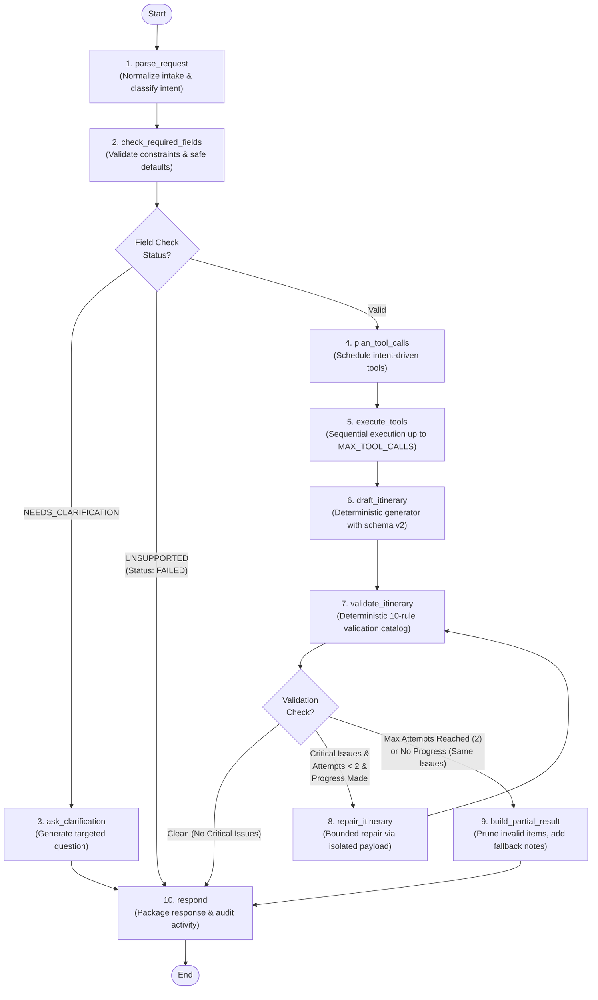

# Agent Workflow & Reliability Specification (Phases 3–4)

This document provides the definitive architectural specification for the LangGraph-powered travel research agent in AI Travel Concierge. It documents the state machine topology, state schema contracts, typed tools, multi-tool routing, execution bounds, unified provider error classification, deterministic validation rules, bounded repair loops, safe partial degradation, structured logging events, and runbook links.

---

## 1. Architectural Overview & Boundaries

- **Product Purpose**: An AI-assisted travel research and itinerary discovery concierge that organizes activities, estimates travel pacing, calculates transit routes, and provides meteorological context.
- **Strict Non-Booking Boundary**: The application is **NOT a booking engine**. It never claims to execute reservations, process payments, purchase tickets, issue flight/hotel confirmations, or process cancellations. All prompts, error handlers, and output nodes strictly enforce this invariant.
- **Execution Model**: A controlled, deterministic state machine orchestrated via LangGraph. The engine operates with deterministic rule-based gateways by default, executing without external LLM dependencies, API key costs, or uncontrolled network loops.

---

## 2. State Machine Graph Topology

The agent workflow is implemented as a compiled `langgraph.graph.StateGraph` using pure execution nodes and conditional edge dispatchers:



---

## 3. TripState Schema Contract

All workflow operations mutate a strongly typed Pydantic `TripState` instance ([`app/agent/state.py`](file:///d:/ai-travel-concierge/backend/app/agent/state.py)):

| Field Name | Type | Description |
| :--- | :--- | :--- |
| `request_id` | `str` | Bounded identifier (max 64 characters) tracking request provenance. |
| `user_message` | `str` | Raw user intake text (strictly validated up to 2000 characters). |
| `intent` | `Intent` | Classified intent: `ITINERARY_PLANNING`, `WEATHER_PLANNING`, `DESTINATION_DISCOVERY`, `ROUTE_PLANNING`, or `UNSUPPORTED`. |
| `known_fields` | `dict[str, Any]` | Sanitized map of extracted parameters; rejects secret-bearing keys (`api_key`, `token`, `secret`, etc.). |
| `missing_fields` | `list[str]` | Essential planning fields missing from user input (e.g., `["destination", "dates"]`). |
| `contradictions` | `list[str]` | Identified constraint conflicts (e.g., reversed dates, `origin == destination`). |
| `trip_request` | `TripRequest \| None` | Validated Pydantic intake model once all essential fields are resolved. |
| `planned_tool_calls` | `list[ToolCall]` | Queue of typed tool invocations scheduled for execution. |
| `tool_results` | `list[ToolResult]` | Execution records captured from tool implementations. |
| `itinerary_draft` | `ItineraryV2 \| None` | Synthesized day-by-day travel plan generated according to Schema v2. |
| `validation_issues` | `list[ValidationIssue]` | Constraint violations flagged during deterministic review. |
| `repair_attempts` | `int` | Bounded counter tracking repair cycles (capped at 2). |
| `last_critical_issues` | `list[str] \| None` | Signatures of critical issues from previous repair iteration for no-progress detection. |
| `step_count` | `int` | Execution step guard tracking node transitions (capped at 25). |
| `clarification_question` | `str \| None` | Targeted prompt presented to the traveler to resolve ambiguities. |
| `status` | `RunStatus` | Execution state: `NEEDS_CLARIFICATION`, `COMPLETED`, `PARTIAL`, or `FAILED`. |
| `warnings` | `list[str]` | Sanitized notices regarding defaulted parameters or degraded tool data. |
| `low_budget` | `bool` | Flag set when daily per-person budget is below 50 currency units. |
| `final_response` | `TripResponse \| None` | Final structured response envelope for completed/partial runs. |
| `tool_activity` | `list[ToolActivity]` | Sanitized, human-readable audit trail entries for UI rendering. |

---

## 4. Typed Tool Contracts (Three Registered Tools)

All tools adhere to strict typed contracts defined in [`app/agent/tools/contracts.py`](file:///d:/ai-travel-concierge/backend/app/agent/tools/contracts.py) and registered in [`app/agent/tools/registry.py`](file:///d:/ai-travel-concierge/backend/app/agent/tools/registry.py):

### 1. `geocode_destination`
- **Purpose**: Resolve geographical coordinates, administrative region, and timezone for a place name.
- **Provider**: Open-Meteo Geocoding API (`https://geocoding-api.open-meteo.com/v1/search`).
- **Attribution**: *"Geocoding data by Open-Meteo.com"*.
- **Arguments**: `{"query": str}` (e.g., `"Rome"`, `"Tokyo"`).
- **Returns**: `ToolResult` containing list of coordinate objects with latitude, longitude, country, and timezone.
- **Failure Handling**: If geocoding fails or returns empty, downstream tools are safely skipped; the workflow transitions to `RunStatus.FAILED` with a user guidance message.

### 2. `get_weather`
- **Purpose**: Fetch daily meteorological forecast summary for target dates.
- **Provider**: Open-Meteo Weather Forecast API (`https://api.open-meteo.com/v1/forecast`).
- **Attribution**: *"Weather data by Open-Meteo.com"*.
- **Arguments**: `{"latitude": float, "longitude": float, "start_date": str, "end_date": str}`.
- **Returns**: `ToolResult` containing daily weather summaries (temperatures, precipitation, weather codes).
- **Failure Handling**: If weather lookup times out or fails, workflow degrades safely to `RunStatus.PARTIAL`, omitting weather without disrupting itinerary generation.

### 3. `get_route_context`
- **Purpose**: Calculate travel distance (km) and estimated transit duration between coordinates.
- **Provider**: OpenRouteService (`https://api.openrouteservice.org/v2/directions`) with deterministic offline Haversine distance and heuristic transit duration fallback.
- **Attribution**: *"Routing data © OpenStreetMap contributors"*.
- **Arguments**: `{"origin_lat": float, "origin_lon": float, "dest_lat": float, "dest_lon": float, "profile": str = "driving-car"}`.
- **Returns**: `ToolResult` containing `distance_km`, `duration_minutes`, and route summary.
- **Failure Handling**: When OpenRouteService is unreachable or `ROUTING_PROVIDER_MODE="mock"`, degrades seamlessly to offline Haversine geodesic calculations without network calls.

---

## 5. Execution Bounds & Guardrails Table

| Parameter / Guard | Real Value | Source Location | Enforcement Behavior |
| :--- | :-: | :--- | :--- |
| **Max Tool Calls (`MAX_TOOL_CALLS`)** | **`5`** | [`app/core/config.py`](file:///d:/ai-travel-concierge/backend/app/core/config.py#L16) | Hard cap on sequential tool invocations across any intent. |
| **Tool Calls: `DESTINATION_DISCOVERY`** | **`1`** | [`app/agent/nodes.py`](file:///d:/ai-travel-concierge/backend/app/agent/nodes.py#L300) | Schedules only destination geocoding. |
| **Tool Calls: `WEATHER_PLANNING`** | **`2`** | [`app/agent/nodes.py`](file:///d:/ai-travel-concierge/backend/app/agent/nodes.py#L310) | Schedules destination geocoding + weather forecast. |
| **Tool Calls: `ROUTE_PLANNING`** | **`4`** | [`app/agent/nodes.py`](file:///d:/ai-travel-concierge/backend/app/agent/nodes.py#L320) | Schedules destination geocode + origin geocode + waypoint geocode + route context. |
| **Tool Calls: `ITINERARY_PLANNING`** | **`5`** | [`app/agent/nodes.py`](file:///d:/ai-travel-concierge/backend/app/agent/nodes.py#L330) | Schedules destination geocode + weather forecast + route context pairs (capped at 5). |
| **Max Retry Attempts (`max_retries`)** | **`2`** | [`app/core/retry.py`](file:///d:/ai-travel-concierge/backend/app/core/retry.py#L15) | Maximum retries on transient provider errors (up to 3 total attempts). |
| **Initial Retry Backoff (`base_delay`)** | **`0.5s`** | [`app/core/retry.py`](file:///d:/ai-travel-concierge/backend/app/core/retry.py#L16) | Initial exponential backoff delay before scaling. |
| **Max Retry Delay Ceiling (`max_delay`)** | **`4.0s`** | [`app/core/retry.py`](file:///d:/ai-travel-concierge/backend/app/core/retry.py#L18) | Ceiling for any individual retry backoff interval. |
| **Cumulative Retry Budget (`budget`)** | **`8.0s`** | [`app/core/retry.py`](file:///d:/ai-travel-concierge/backend/app/core/retry.py#L19) | Hard cumulative deadline across all retry attempts. |
| **Max Repair Attempts** | **`2`** | [`app/core/config.py`](file:///d:/ai-travel-concierge/backend/app/core/config.py#L17) | Maximum bounded repair loops before routing to partial degradation. |
| **No-Progress Early Stop** | **`1` attempt** | [`app/agent/graph.py`](file:///d:/ai-travel-concierge/backend/app/agent/graph.py#L158) | If repair attempt produces identical critical issue signatures, halts early. |
| **Step Count Guard (`max_steps`)** | **`25`** | [`app/core/config.py`](file:///d:/ai-travel-concierge/backend/app/core/config.py#L18) | LangGraph recursion guard ceiling; aborts with `FAILED` if exceeded. |
| **User Message Length** | **`2000` chars** | [`app/agent/state.py`](file:///d:/ai-travel-concierge/backend/app/agent/state.py) | Input messages exceeding 2000 characters are rejected by schema validators. |
| **Max Trip Duration** | **`30` days** | [`app/agent/nodes.py`](file:///d:/ai-travel-concierge/backend/app/agent/nodes.py) | Date ranges exceeding 30 days trigger a contradiction requiring clarification. |
| **Party Size Bounds** | **`1 – 20`** | [`app/agent/nodes.py`](file:///d:/ai-travel-concierge/backend/app/agent/nodes.py) | Party sizes outside 1–20 travelers trigger a contradiction requiring clarification. |

---

## 6. Unified Provider Error Model

Defined in [`app/providers/errors.py`](file:///d:/ai-travel-concierge/backend/app/providers/errors.py), all external service exceptions map into a canonical `ProviderError`:

```python
class ErrorCode(StrEnum):
    TIMEOUT = "timeout"
    RATE_LIMITED = "rate_limited"
    AUTHENTICATION_FAILED = "authentication_failed"
    INVALID_RESPONSE = "invalid_response"
    INVALID_REQUEST = "invalid_request"
    UNKNOWN_FAILURE = "unknown_failure"
```

### Retryability Classification:
- **Retryable (`err.retryable == True`)**:
  - `TIMEOUT`: Network read/connect timeouts.
  - `RATE_LIMITED`: HTTP 429 when `Retry-After <= remaining_budget`.
  - Transient 502, 503, 504 gateway and server errors.
- **Non-Retryable (`err.retryable == False`)**:
  - `AUTHENTICATION_FAILED`: HTTP 401 Unauthorized or 403 Forbidden (halts immediately after attempt 1).
  - `INVALID_REQUEST`: Client-side HTTP 400 Bad Request or malformed coordinates.
  - `INVALID_RESPONSE`: Unparseable response JSON or schema violations.

---

## 7. Itinerary Schema v2 & Non-Destructive Upgrader

Defined in [`app/schemas/itinerary_v2.py`](file:///d:/ai-travel-concierge/backend/app/schemas/itinerary_v2.py), Schema v2 introduces structured activities, fine-grained duration estimates, explicit provenance, and cost tracking:

- **Root Itinerary (`ItineraryV2`)**:
  - `schema_version = 2`
  - `days: list[ItineraryDayV2]`
  - `sources: list[SourceInfo]` (required metadata for all retrieved claims)
  - `uncertainty_notes: list[str]`
- **Activity Entry (`ItineraryActivityV2`)**:
  - `id`: Unique identifier (e.g., `day_1_act_1`).
  - `title`, `description`, `time_of_day`, `interest_tags`.
  - `location`: `ActivityLocation` (`name`, `latitude`, `longitude`, `source_ref`).
  - `duration_estimate`: `DurationEstimate` (`min_minutes`, `max_minutes`, `basis = DurationBasis.PROVIDER | HEURISTIC | UNKNOWN`).
  - `source_refs`: List of source URLs matching root `sources`.
  - `provenance`: `Provenance.RETRIEVED` | `GENERATED_SUGGESTION`.
  - `cost_status`: `CostStatus.UNKNOWN` | `ESTIMATE` | `RETRIEVED`.
  - `uncertainty_notes`: List of explicit caveats and boundary notes.
- **Non-Destructive Upgrader (`upgrade_itinerary_v1_to_v2`)**:
  - Upgrades stored Phase 2 v1 JSON structures in-memory to Schema v2.
  - Automatically migrates legacy `items` into `activities`, defaults duration bases to `HEURISTIC`, and derives safe `CostStatus`.

---

## 8. Deterministic Validation Rule Catalog (All Implemented)

Defined in [`app/agent/validation.py`](file:///d:/ai-travel-concierge/backend/app/agent/validation.py), the deterministic validation engine evaluates 10 strict rules:

| Rule Code | Severity | Description | Status |
| :--- | :-: | :--- | :-: |
| `DATE_RANGE_MISMATCH` | **CRITICAL** | Day numbers must be sequential 1..N and match requested date span exactly. | **IMPLEMENTED** |
| `DUPLICATE_ACTIVITY` | **WARNING / CRITICAL** | Repeated activity title/location. 1–2 duplicates = Warning; 3+ duplicates = Critical. Exempt categories: meals/dining/rest. | **IMPLEMENTED** |
| `MAX_DAILY_ACTIVITIES` | **WARNING** | Daily activity count must respect pacing cap (Relaxed: 3, Balanced: 4, Packed: 5). | **IMPLEMENTED** |
| `MISSING_REQUIRED_INTEREST` | **WARNING** | Requested travel interest is omitted from all scheduled activities. | **IMPLEMENTED** |
| `MISSING_SOURCE_METADATA` | **CRITICAL** | Activity marked `provenance="retrieved"` or `cost_status="retrieved"` lacks valid matching `SourceInfo` in root sources. | **IMPLEMENTED** |
| `BUDGET_FLOOR_VIOLATION` | **WARNING** | Specified budget falls below minimum daily per-person threshold (50 currency units). | **IMPLEMENTED** |
| `MISSING_PROVENANCE` | **CRITICAL** | Activity lacks explicit `Provenance` classification. | **IMPLEMENTED** |
| `BOOKING_LANGUAGE_DETECTED` | **CRITICAL** | Prohibited transactional terms detected (*"booking confirmed"*, *"tickets issued"*, *"payment processed"*, *"reservation made"*). | **IMPLEMENTED** |
| `WEATHER_WITHOUT_TOOL_SUCCESS` | **CRITICAL** | Detailed weather claims in activities when `get_weather` tool failed or was skipped. | **IMPLEMENTED** |
| `INVALID_COST_STATUS` | **CRITICAL** | Cost status claims contradict activity provenance or missing source references. | **IMPLEMENTED** |

---

## 9. Safe Partial-Result Degradation Behaviour

When critical issues cannot be resolved after bounded repair attempts (`MAX_REPAIR_ATTEMPTS = 2`) or when transient provider outages occur:
1. **Never Mark Completed**: The response node unconditionally guarantees that an itinerary with critical validation issues is **NEVER returned with status `RunStatus.COMPLETED`**.
2. **Safe Pruning (`build_partial_result`)**:
   - Strips activities with unresolvable critical issues (e.g. unverified retrieved claims, forbidden booking language).
   - Replaces pruned slots with safe free exploration suggestions (`provenance=GENERATED_SUGGESTION`).
   - Appends prominent user-facing warning notices explaining unavailable data.
   - Sets terminal status to `RunStatus.PARTIAL` (or `RunStatus.FAILED` if zero valid activities remain).

---

## 10. Structured Logging Events & Runbook Link

All nodes, tools, retries, and repair cycles emit single-line structured JSON logs to `stdout` under `app.events` ([`app/core/logging.py`](file:///d:/ai-travel-concierge/backend/app/core/logging.py)):

### Canonical Log Events:
- `node_start` / `node_end`: Graph node boundary transitions with execution latency.
- `tool_call_start` / `tool_call_end`: Tool execution tracking with latency and status.
- `retry_scheduled`: Bounded retry scheduled with attempt count, backoff delay, and error code.
- `repair_start` / `repair_end`: Bounded repair iterations with flagged issue codes.
- `validation_result`: Validation pass outcomes, issue counts, and severities.

### Redaction & Privacy Guarantee:
- API keys (`sk-...`, `AKIA...`, `ghp_...`, Bearer tokens) are redacted to `[REDACTED]`.
- All URL query parameters are stripped before emission.
- Raw user messages are reduced to length metrics (`[USER_MESSAGE len=N]`).
- Raw prompt and completion texts are never emitted.

### Diagnostic Runbook:
For log searching, filtering by `request_id`, and step-by-step failure diagnosis procedures, see the comprehensive runbook:
- [`docs/runbooks/debugging-failures.md`](file:///d:/ai-travel-concierge/docs/runbooks/debugging-failures.md)
