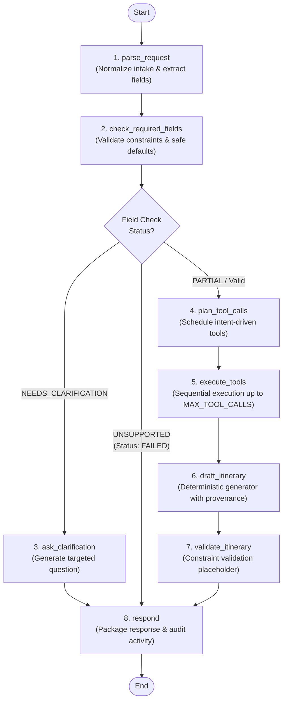

# Phase 3 Agent Workflow Specification

This document provides the definitive architectural specification for the Phase 3 LangGraph-powered travel research agent in AI Travel Concierge. It documents the state machine topology, state schema contracts, typed tools, routing bounds, failure policies, sanitization rules, verified test commands, and non-goals.

---

## 1. Architectural Overview & Boundaries

- **Product Purpose**: An AI-assisted travel research and itinerary discovery concierge that organizes activities, estimates daily pacing, and provides meteorological context.
- **Strict Non-Booking Boundary**: The application is **NOT a booking engine**. It never claims to execute reservations, process payments, purchase tickets, issue flight confirmations, or process cancellations. All prompts, error handlers, and output nodes strictly enforce this invariant.
- **Execution Model**: A controlled, deterministic state machine orchestrated via LangGraph. The engine operates with deterministic rule-based gateways by default, executing without external LLM dependencies, API key costs, or uncontrolled network loops.

---

## 2. State Machine Graph Topology

The agent workflow is implemented as a compiled `langgraph.graph.StateGraph` using pure execution nodes and conditional edge dispatchers.



---

## 3. TripState Schema Contract

All workflow operations mutate a strongly typed Pydantic `TripState` instance (`app/agent/state.py`):

| Field Name | Type | Description |
| :--- | :--- | :--- |
| `request_id` | `str` | Bounded identifier (max 64 characters) tracking request provenance. |
| `user_message` | `str` | Raw user intake text (strictly validated up to 2000 characters). |
| `intent` | `Intent` | Classified intent: `ITINERARY_PLANNING`, `WEATHER_PLANNING`, `DESTINATION_DISCOVERY`, or `UNSUPPORTED`. |
| `known_fields` | `dict[str, Any]` | Sanitized map of extracted parameters; rejects secret-bearing keys (`api_key`, `token`, `secret`, etc.). |
| `missing_fields` | `list[str]` | Essential planning fields missing from user input (e.g., `["origin", "dates"]`). |
| `contradictions` | `list[str]` | Identified constraint conflicts (e.g., reversed dates, `origin == destination`). |
| `trip_request` | `TripRequest \| None` | Validated Pydantic intake model once all essential fields are resolved. |
| `planned_tool_calls` | `list[ToolCall]` | Queue of typed tool invocations scheduled for execution. |
| `tool_results` | `list[ToolResult]` | Execution records captured from tool implementations. |
| `itinerary_draft` | `Itinerary \| None` | Synthesized day-by-day travel plan generated by the deterministic engine. |
| `validation_issues` | `list[str]` | Constraint violations flagged during itinerary review. |
| `repair_attempts` | `int` | Bounded counter tracking repair cycles (capped at 2). |
| `step_count` | `int` | Execution step guard tracking node transitions (capped at 25). |
| `clarification_question` | `str \| None` | Targeted prompt presented to the traveler to resolve ambiguities. |
| `status` | `RunStatus` | Execution state: `NEEDS_CLARIFICATION`, `COMPLETED`, `PARTIAL`, or `FAILED`. |
| `warnings` | `list[str]` | Sanitized notices regarding defaulted parameters or degraded tool data. |
| `low_budget` | `bool` | Flag set when daily per-person budget is below 50 currency units. |
| `final_response` | `TripResponse \| None` | Final structured response envelope for completed/partial runs. |
| `tool_activity` | `list[ToolActivity]` | Sanitized, human-readable audit trail entries for UI rendering. |

---

## 4. Typed Tool Contracts

All tools adhere to strict typed contracts defined in `app/agent/tools/contracts.py`:

### Tool: `geocode_destination`
- **Purpose**: Resolve geographical coordinates, administrative region, and timezone for a city name.
- **Arguments**:
  ```python
  {"query": str}  # Destination query string (e.g., "Rome", "Tokyo")
  ```
- **Returns**:
  ```python
  ToolResult(
      tool_name="geocode_destination",
      status=ToolStatus.OK,       # or EMPTY, TIMEOUT, ERROR
      data=[{
          "name": str,
          "country": str,
          "latitude": float,
          "longitude": float,
          "timezone": str
      }],
      source=SourceInfo(provider="Open-Meteo", url="https://geocoding-api.open-meteo.com/v1/search"),
      data_origin="mock" | "live"
  )
  ```
- **Error Codes**: `ToolErrorCode.SERVICE_UNAVAILABLE`, `ToolErrorCode.TIMEOUT`, `ToolErrorCode.NOT_FOUND`.

### Tool: `get_weather`
- **Purpose**: Fetch daily meteorological forecast summary for target dates.
- **Arguments**:
  ```python
  {
      "latitude": float,    # Resolved from geocoding
      "longitude": float,   # Resolved from geocoding
      "start_date": str,    # ISO date "YYYY-MM-DD"
      "end_date": str       # ISO date "YYYY-MM-DD"
  }
  ```
- **Returns**:
  ```python
  ToolResult(
      tool_name="get_weather",
      status=ToolStatus.OK,       # or TIMEOUT, RATE_LIMITED, ERROR
      data=WeatherSummary(...).model_dump(mode="json"),
      source=SourceInfo(provider="Open-Meteo", url="https://api.open-meteo.com/v1/forecast"),
      data_origin="mock" | "live"
  )
  ```
- **Error Codes**: `ToolErrorCode.OUT_OF_FORECAST_RANGE` (>16 days out), `ToolErrorCode.TIMEOUT`, `ToolErrorCode.MALFORMED_RESPONSE`.

---

## 5. Execution Bounds & Guardrails (Values from Source Code)

| Parameter / Guard | Value | Source Location | Enforcement Behavior |
| :--- | :-: | :--- | :--- |
| **Step Count Guard** | `25` | `app/agent/nodes.py` (`respond()`) | If `step_count >= 25`, workflow immediately aborts with `status = RunStatus.FAILED`. |
| **Max Tool Calls** | `5` | `app/core/config.py` (`MAX_TOOL_CALLS`) | Limits tool executions per run; surplus tool calls are skipped with a warning. |
| **User Message Length** | `2000` chars | `app/agent/state.py` (`TripState`) | Pydantic validator rejects or truncates inputs exceeding 2000 characters. |
| **Request ID Length** | `64` chars | `app/agent/state.py` (`TripState`) | Request IDs exceeding 64 chars are bounded to prevent resource exhaustion. |
| **Max Trip Duration** | `30` days | `app/agent/nodes.py` (`check_required_fields`) | Durations > 30 days trigger a contradiction and require clarification. |
| **Party Size Limit** | `1 - 20` | `app/agent/nodes.py` (`check_required_fields`) | Party sizes outside 1–20 travelers trigger a contradiction. |
| **Forecast Horizon** | `16` days | `app/services/weather.py` | Dates beyond 16 days degrade to `PARTIAL` with an out-of-range forecast warning. |

---

## 6. Clarification & Safe Defaults Policy

To ensure travel plans reflect authentic traveler preferences while minimizing unnecessary friction:

### Essential Fields (Never Defaulted — Clarification Required)
If any of these fields are missing or contradictory, the agent **never guesses**; it immediately transitions to `RunStatus.NEEDS_CLARIFICATION`:
1. `destination`: Destination city or region.
2. `origin`: Departure city or airport.
3. `start_date` & `end_date`: Departure and return dates (must be valid, future, ordered ISO dates).
4. `party_size`: Number of travelers (1–20).

### Safe Defaults (Explicitly Allowed & Announced)
Defaults are permitted **only** for non-safety travel preferences and must be declared in response warnings:
1. **Pace**: Defaults to `"balanced"` (recorded in `warnings`).
2. **Interests**: Defaults to empty list `[]` (general recommendations applied; recorded in `warnings`).
3. **Budget**: Defaults to `None` (costs marked as unspecified; recorded in `warnings`).

---

## 7. Failure & Partial Degradation Policy

The system guarantees honest, graceful degradation across all failure modes:

| Failure Scenario | Internal Condition | Terminal RunStatus | User Experience / UI Behavior |
| :--- | :--- | :-: | :--- |
| **Unsupported Intent** | Booking / transaction keywords detected | `FAILED` | Polite explanation: "Flight/hotel bookings and transactions are out of scope." |
| **Destination Not Found** | Geocoding returns `EMPTY` or `[]` | `FAILED` | Clear advice: "Could not find that destination. Please check spelling or add country name." |
| **Geocoding Timeout / Error** | Geocoding returns `TIMEOUT` or `ERROR` | `FAILED` | Safe retry message: "Destination lookup encountered a temporary error. Please try again later." |
| **Weather Timeout / Error** | Weather returns `TIMEOUT`, `ERROR`, or out-of-range | `PARTIAL` | **Itinerary is preserved intact**; `weather=None`; prominent amber alert notice rendered explaining missing weather. |
| **Malformed Tool Payload** | Tool output missing required schema fields | `PARTIAL` or `FAILED` | Catches `ValidationError` without crash; omits corrupted component and appends explanatory warning. |
| **Cyclic Execution** | `step_count >= 25` | `FAILED` | Halts execution loop; returns polite error explaining guardrail limit was reached. |

---

## 8. Logging, Redaction & Privacy Specifications

To protect user confidentiality and prevent accidental credential exposure:
1. **URL Sanitization (`sanitize_url()`)**: All provider URLs displayed in tool activity logs are stripped of query parameters and hash fragments (e.g., `https://api.provider.com/v1/search?key=secret` -> `https://api.provider.com/v1/search`).
2. **Secret Key Scrubbing**: `TripState.known_fields` strictly rejects secret-bearing keys (`api_key`, `token`, `password`, `secret`, `credential`, `private_key`).
3. **Inert Storage**: Hostile input strings (SQL syntax, directory traversal paths, CRLF newlines) are stored as inert text strings and never passed to database concatenations or shell commands.
4. **Attribution Transparency**: Every retrieved fact includes provider name, attribution string, source URL, and `data_origin` badge (`"live"` vs `"mock"`).

---

## 9. Verified Test Commands

All workflow capabilities are verified by automated test suites executed from repository root:

```powershell
# Run adversarial robustness test suite (24 tests)
.\backend\.venv\Scripts\python.exe -m pytest -q backend\tests\test_agent_adversarial.py

# Run full agent test suite (workflow, clarification, tools, state, generator)
.\backend\.venv\Scripts\python.exe -m pytest -o pythonpath=backend -q backend\tests

# Run frontend assistant UI test suite (83 tests)
npm --prefix frontend run test

# Verify production Next.js build prerendering /assistant
npm --prefix frontend run build
```

*(Bash alternatives: replace `\` with `/` and use `./backend/.venv/bin/python`)*.

---

## 10. Explicit "Not Implemented" List (Phase 3 Boundaries)

The following capabilities are deliberately **NOT implemented** in Phase 3 to preserve architectural simplicity:
- **No Booking or Payment Engine**: No ticketing, credit card processing, reservation holds, or booking confirmations.
- **No Live Flights or Hotels Inventory**: No GDS, Amadeus, Skyscanner, or hotel booking integrations.
- **No Live LLM API Keys or Inference Costs**: Graph execution is powered by deterministic rule-based engines (`RuleBasedGateway`).
- **No Generic RAG or Document Uploads**: No PDF parsers, unstructured document intake, or vector databases (Pinecone, Chroma, pgvector).
- **No Autonomous Multi-Agent Swarms**: System runs as a single modular LangGraph workflow without inter-agent messaging or Redis queues.
- **No User Authentication / Sessions**: Authentication is deferred to future architecture milestones.
