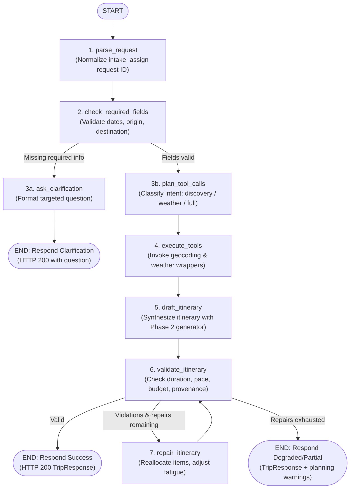

# Phase 3 Agent Architecture & Controlled Workflow Specification

- **Date**: 2026-10-29
- **Status**: **Approved Architectural Design**
- **Author**: AI Travel Concierge Architecture & Planning Team
- **Component**: Backend Agent Service (`backend/app/agent/`)
- **Strict Boundary**: AI Travel Concierge is a travel discovery and planning assistant, **NOT a booking engine**. It never claims to execute bookings, purchases, reservations, tickets, or cancellations.

---

## 1. Architectural Overview & Design Philosophy

Phase 3 introduces controlled, state-machine-driven agent orchestration using **LangGraph** (`StateGraph`) and **LangChain-Core** without resorting to chaotic autonomous multi-agent swarms.

The design is governed by five foundational principles:
1. **Deterministic Guardrails**: The agent operates as a finite state machine with strict recursion limits, bounded tool calls, and finite repair budgets.
2. **Layer Separation & Zero Duplication**: Agent tools are thin, typed wrappers around existing Phase 2 adapters (`app.providers.open_meteo.client.OpenMeteoClient`) and domain generators (`app.services.itinerary.generate_itinerary`). No provider logic or data schemas are duplicated.
3. **Truthfulness & Provenance**: Every piece of data carries explicit provenance (`retrieved`, `generated_suggestion`, `estimate`, `unknown`). Weather and coordinates are never hallucinated.
4. **Default Offline Determinism**: A `ModelGateway` abstraction provides a deterministic rule-based implementation as the default engine. Live LLM calls are strictly optional, disabled by default, and never required for unit tests or acceptance.
5. **Human-in-the-Loop Clarification**: When user requests are ambiguous or incomplete, the workflow halts cleanly at a clarification seam rather than making unfounded assumptions.

---

## 2. Module Layout (`backend/app/agent/`)

The agent engine is isolated within `backend/app/agent/` as a modular monolith subsystem:

```text
backend/app/agent/
├── __init__.py           # Public exports (AgentWorkflow, TripState, ModelGateway)
├── state.py              # TypedDict state schema (TripState), reducers, and metadata
├── graph.py              # LangGraph StateGraph assembly, compilation, and recursion limit
├── gateway.py            # ModelGateway protocol: Deterministic (default), ScriptedFake, and OptionalLLM
├── errors.py             # Agent exception taxonomy and error envelope mapping
├── validation.py         # Itinerary constraint validation and repair check rules
├── nodes/                # Pure node execution functions
│   ├── __init__.py
│   ├── parse.py          # parse_request: intake normalization and request-ID binding
│   ├── validation.py     # check_required_fields: verifies dates, locations, boundaries
│   ├── clarification.py  # ask_clarification: formats targeted single clarification question
│   ├── planning.py       # plan_tool_calls: classifies user intent and selects tools
│   ├── execution.py      # execute_tools: invokes typed tool wrappers with timeouts
│   ├── drafting.py       # draft_itinerary: synthesizes daily plan using Phase 2 engine
│   └── repair.py         # repair_itinerary: adjusts schedule or pacing on rule violations
└── tools/                # Narrow, typed tools wrapping Phase 2 adapters
    ├── __init__.py
    ├── geocode.py        # geocode_tool: wraps OpenMeteoClient.search_destination
    └── weather.py        # weather_tool: wraps OpenMeteoClient.get_daily_forecast
```

### Layer Rules
- **No Duplicate Logic**: The tools under `app/agent/tools/` MUST directly call `app.providers.open_meteo.OpenMeteoClient` and reuse schemas from `app.schemas.provider` and `app.schemas.trip`.
- **Pure Nodes**: Nodes take `TripState` as input and return partial dictionary updates to mutate state immutably.
- **Fail-Safe Isolation**: Tool failures (timeouts, HTTP 5xx, rate limits) are trapped by the execution node and stored in `tool_errors` without crashing the graph runtime.

---

## 3. Workflow Graph Architecture

The workflow is constructed using `langgraph.graph.StateGraph` with explicit entry, conditional routing, and repair loops:



---

## 4. `TripState` Data Contract

The workflow state is defined as a typed dictionary conforming to LangGraph standards:

```python
from typing import Annotated, Literal, TypedDict
from datetime import date, datetime
from app.schemas.trip import TripRequest, Itinerary, TripResponse
from app.schemas.provider import GeocodeResult, WeatherSummary, SourceInfo

class ToolCallRecord(TypedDict):
    tool_name: str
    arguments: dict[str, object]
    status: Literal["success", "failed", "skipped"]
    error_message: str | None
    execution_time_ms: float
    data_origin: Literal["live", "mock"]

class TripState(TypedDict, total=False):
    # 1. Intake and Identity
    request_id: str
    request: TripRequest
    raw_user_input: str

    # 2. Intent & Routing
    intent: Literal[
        "destination_discovery",
        "weather_planning",
        "full_itinerary",
        "clarification_response"
    ]

    # 3. Clarification Seam
    clarification_needed: bool
    clarification_field: str | None
    clarification_question: str | None

    # 4. Retrieved Tool Data (Strict Provenance)
    geocode_result: GeocodeResult | None
    weather_summary: WeatherSummary | None
    tool_history: list[ToolCallRecord]
    tool_errors: list[str]
    tool_call_count: int

    # 5. Itinerary Synthesis & Repair
    draft_itinerary: Itinerary | None
    validation_errors: list[str]
    repair_attempts: int
    max_repairs_reached: bool

    # 6. Final Outputs & Diagnostic Warnings
    final_response: TripResponse | None
    warnings: list[str]
    workflow_status: Literal[
        "in_progress",
        "clarification_required",
        "completed",
        "degraded",
        "failed"
    ]
```

---

## 5. Intent Routing & Tool Contracts

### Intent Classification
The `plan_tool_calls` node maps user intake into bounded tool execution paths:

| Intent Type | Trigger Condition | Tools Executed | Expected Output |
| :--- | :--- | :--- | :--- |
| **`destination_discovery`** | User provides destination name only; dates omitted or flexible. | `geocode_tool` | Resolved coordinates, country, timezone, administrative region. |
| **`weather_planning`** | Destination and dates provided; requests weather feasibility. | `geocode_tool` -> `weather_tool` | Daily forecast breakdown, precipitation risks, seasonal context. |
| **`full_itinerary`** | Full `TripRequest` provided (dates, party size, pace, interests). | `geocode_tool` -> `weather_tool` -> `draft_itinerary` | Complete 1-to-30 day structured itinerary with provenance tags. |

### Low-Budget & Constraint Flags
- **Low Budget Detection**: When `budget_amount / (days * party_size) < 50` units, state marks `low_budget_flag=True`. `draft_itinerary` filters activity templates to prioritize free public landmarks, parks, and walking tours.
- **Out-of-Horizon Dates**: When trip dates exceed 16 days from today, `weather_tool` safely bypasses daily forecast calls, returning a seasonal advisory note without failing the itinerary synthesis.

---

## 6. Execution Bounds & Guardrails

To prevent runaway loops, resource exhaustion, and high API costs, the state machine enforces strict structural bounds:

```python
# Hard limits enforced across the agent engine
MAX_TOOL_CALLS: int = 5            # Maximum tool invocations per workflow run
MAX_REPAIR_ATTEMPTS: int = 2       # Maximum repair iterations in validation loop
GRAPH_RECURSION_LIMIT: int = 25    # Super-step execution ceiling for StateGraph
PER_TOOL_TIMEOUT_SECONDS: float = 5.0 # HTTP read/connect timeout per tool
MAX_TOOL_RETRIES: int = 1          # Maximum retries on transient network errors
```

- **Cycle Guard**: Invocations call `graph.invoke(state, config={"recursion_limit": GRAPH_RECURSION_LIMIT})`. If a logic cycle occurs, LangGraph halts and raises `GraphRecursionError`.
- **Exhaustion Handling**: When `repair_attempts >= MAX_REPAIR_ATTEMPTS`, the graph branches to `respond_partial`, appending warnings rather than crashing.

---

## 7. ModelGateway Protocol Decision

To ensure deterministic reliability, zero cost during development, and resilience in air-gapped test environments, all model interactions are governed by a **`ModelGateway`** protocol:

```python
from typing import Protocol

class ModelGateway(Protocol):
    async def classify_intent(self, user_input: str) -> str: ...
    async def generate_clarification(self, missing_field: str) -> str: ...
    async def synthesize_activity_notes(self, context: dict) -> str: ...
```

### Three Implementations
1. **`DeterministicRuleGateway` (DEFAULT)**:
   - Pure Python rule engine using regex, keyword parsing, and template lookup.
   - Zero external network egress, zero API keys required, instant sub-millisecond execution.
   - Used by default in development and production environments unless an LLM is explicitly configured.
2. **`ScriptedFakeGateway` (TEST HARNESS)**:
   - Configurable mock gateway for unit and integration testing.
   - Allows injecting simulated timeouts, malformed outputs, and canned clarification responses.
3. **`OptionalLLMGateway` (OPTIONAL)**:
   - Provider-agnostic adapter for external models (Anthropic Claude, OpenAI, Google Gemini).
   - Enabled ONLY when `LLM_PROVIDER` and `LLM_API_KEY` are explicitly present in environment.
   - **Rule**: Phase 3 acceptance and CI test suites must NEVER require `OptionalLLMGateway` or live API credentials to pass.

---

## 8. Clarification Policy & Safe Defaults

The agent strictly follows a polite, human-centered clarification policy:

1. **One Question at a Time**: Never overwhelm the traveler with a multi-part questionnaire.
2. **Actionable Options**: When asking for clarification, provide suggested choices (e.g. *"Did you mean Paris, France or Paris, Texas?"*).
3. **Safe Fallback Defaults**:
   - If `pace` is omitted -> defaults to `PacePreference.BALANCED`.
   - If `party_size` is omitted -> defaults to `1`.
   - If `interests` are omitted -> defaults to `["general_sightseeing"]`.
   - If `start_date` or `destination` is omitted -> **Clarification Required** (cannot guess dates or locations).

---

## 9. API Endpoint Plan (`POST /api/agent/plan`)

The agent workflow is exposed via a dedicated FastAPI endpoint:

### Endpoint Specification
- **Path**: `POST /api/agent/plan`
- **Request Envelope**:
  ```json
  {
    "query": "Plan a 4-day trip to Rome in September for 2 people interested in history",
    "request": null,
    "session_id": "optional-uuid"
  }
  ```
- **Response Envelope (Success)**:
  ```json
  {
    "status": "completed",
    "request_id": "req-123e4567-e89b",
    "trip": { ...TripResponse... },
    "warnings": []
  }
  ```
- **Response Envelope (Clarification Required)**:
  ```json
  {
    "status": "clarification_required",
    "request_id": "req-123e4567-e89b",
    "clarification": {
      "field": "start_date",
      "question": "What dates are you planning to visit Rome?"
    }
  }
  ```

### Structured Logging & PII Redaction
- All log messages carry structured correlation context: `request_id`, `session_id`, `node`, `elapsed_ms`.
- **Redaction Rules**: API keys, bearer tokens, traveler email addresses, and phone numbers are scrubbed by a regex filter before emitting logs.

---

## 10. Frontend UI Activity Indicator Plan

To keep the traveler informed during multi-step graph processing, the frontend UI introduces a progressive status stepper:

1. **Intake Processing**: *"Understanding your travel request..."*
2. **Geocoding & Location**: *"Resolving destination coordinates..."*
3. **Weather Retrieval**: *"Fetching daily meteorological forecast..."*
4. **Schedule Synthesis**: *"Generating day-by-day itinerary matching your pace..."*
5. **Quality Verification**: *"Verifying schedule balance and weather adaptations..."*
6. **Completion**: Smoothly transitions to the rendered itinerary display.

---

## 11. Explicit Non-Goals for Phase 3

To prevent scope creep and maintain architectural cleanliness, the following remain **strictly out of scope**:
- **No Booking or Ticketing**: Never claims reservations were made or fares purchased.
- **No Vector Stores**: No embeddings, Chroma, Pinecone, or pgvector.
- **No Redis / Queues**: No distributed workers or Celery queues.
- **No Document Uploads**: No PDF / ticket parsing or arbitrary user file ingestion.
- **No Unbounded Agent Debates**: No multi-agent conversational swarms.
