# Phase 4 & Phase 5 Branch Plan

This document establishes the Git branching model, integration baseline, retention policy for all historical branches (Phases 1–3), planned branch roadmap for Phase 4 and Phase 5, reuse evaluation decisions, manual merge sequencing for the human developer, and independent QA verification protocol for AI Travel Concierge.

---

## 1. Integration Baseline

- **Primary Integration Base**: `develop`
- **Current Integration Commit**: `cc8c2ed` (`docs(phase2-3): document setup and agent workflow`)
- **Baseline Verification**: The `develop` branch incorporates all verified, passing deliverables from Phases 1, 2, and 3:
  - **Phase 1 Foundation**:
    - Modular monolith architecture, workspace formatting (`.editorconfig`, `.gitattributes`, `.gitignore`), and agent guidelines (`AGENTS.md`).
    - FastAPI backend service with structured error envelopes, health endpoints (`/health`, `/health/db`, `/api/version`), and Pydantic configuration (`backend/app/core/config.py`).
    - Next.js 16 + React 19 frontend shell with TypeScript, Tailwind CSS, typed API client (`frontend/src/lib/api/`), and `BackendStatus` component.
    - PostgreSQL 16 containerization via `docker-compose.yml`, SQLAlchemy 2.0 base, and initial Alembic baseline revision (`backend/alembic/versions/0001_baseline.py`).
    - Automated GitHub Actions multi-job CI workflow (`.github/workflows/ci.yml`).
  - **Phase 2 Intake & Deterministic Engine**:
    - Pydantic intake contracts (`TripRequest`) with location normalization, ISO currency allow-listing, and date range constraints (`backend/app/schemas/trip.py`).
    - Resilient Open-Meteo client (`OpenMeteoClient`) with geocoding, daily forecast parsing, retry handling, and offline fixtures (`backend/app/providers/open_meteo/`).
    - Deterministic day-by-day itinerary generator matching pace, duration, interests, and weather summary (`backend/app/services/itinerary.py`).
    - Database persistence models (`Trip`) and API endpoints (`POST /api/trips`, `GET /api/trips/{id}`, `GET /api/trips`).
    - Frontend trip intake form, itinerary card display, weather summary cards, and URL reload support (`frontend/src/app/trips/`).
  - **Phase 3 Controlled LangGraph Orchestration**:
    - LangGraph `StateGraph` workflow assembly (`backend/app/agent/graph.py`) with strict recursion limit (`AGENT_RECURSION_LIMIT = 25`).
    - Typed workflow state (`TripState` in `backend/app/agent/state.py`) capturing user inputs, tool results, missing fields, warnings, and audit entries.
    - Narrow, typed tools (`geocode_tool`, `weather_tool` in `backend/app/agent/tools/`) wrapping Phase 2 providers.
    - Deterministic `ModelGateway` protocol (`backend/app/agent/gateway.py`) ensuring fully offline execution without live LLM dependencies.
    - Human-in-the-loop clarification node (`ask_clarification`) for ambiguous or incomplete inputs.
    - Normalized agent exception taxonomy (`backend/app/agent/errors.py`) with safe error codes (`ToolErrorCode`).
    - Sanitized tool activity audit trail (`ToolActivity`) and structured logging with URL/secret redaction.
    - Frontend interactive assistant page (`frontend/src/app/assistant/`) with real-time tool execution audit cards and clarification prompts.
- **Production Baseline (`main`)**: Commit `5e39fe1` (tag `v0.3.0`, `chore(release): promote Phase 2 and Phase 3 to main (v0.3.0)`). Main is updated strictly by the human developer via milestone merges from `develop`.

---

## 2. Retention Policy for Historical Branches (Phases 1–3)

All 33 historical branches created during Phases 1–3 must be **PERMANENTLY RETAINED** in their exact state. They must **never** be deleted, renamed, rebased, or force-pushed.

| Branch Name | Tip Commit Hash | Milestone Role & Description |
| :--- | :--- | :--- |
| `main` | `5e39fe1` | Production milestone v0.3.0 baseline |
| `develop` | `cc8c2ed` | Active integration base containing all merged Phase 1–3 work |
| `feature/repo-foundation` | `471cc61` | Phase 1 initial repository layout, linters, and conventions |
| `docs/engineering-conventions` | `dc776bf` | Phase 1 engineering guidelines, ADR 0001, and architecture |
| `feature/backend-scaffold` | `ea4cc9b` | Phase 1 FastAPI service factory, health, and version endpoints |
| `feature/frontend-scaffold` | `8e933c9` | Phase 1 Next.js application scaffolding and TypeScript setup |
| `feature/env-config` | `505406c` | Phase 1 typed Pydantic settings and environment templates |
| `feature/health-integration` | `705f388` | Phase 1 frontend BackendStatus component and API client wrapper |
| `feature/frontend-tests` | `c817de7` | Phase 1 Vitest test harness and frontend client unit tests |
| `test/phase1-integration` | `98fe316` | Phase 1 standalone Python smoke test and CORS integration tests |
| `feature/postgres-dev-setup` | `92412e1` | Phase 1 Docker Compose PostgreSQL 16 service container |
| `feature/db-baseline` | `7a950c2` | Phase 1 SQLAlchemy base, session factory, and Alembic baseline |
| `feature/ci-workflow` | `455258c` | Phase 1 multi-job GitHub Actions CI workflow |
| `docs/phase1-setup` | `b6671cc` | Phase 1 README setup guide and architecture notes |
| `feature/deployment-shell` | `ef7433c` | Phase 1 production Dockerfiles for backend and frontend |
| `test/phase1-final-verification` | `2687fd8` | Phase 1 independent QA verification matrix |
| `docs/phase1-release-notes` | `e2de7bf` | Phase 1 release notes (v0.1.0) and root CHANGELOG.md |
| `docs/phase2-3-plan` | `33b498f` | Phase 2–3 branch roadmap and data contracts specification |
| `feature/phase2-trip-schemas` | `82b4a53` | Phase 2 Pydantic trip schemas and database models |
| `feature/phase2-weather-adapter` | `2700fe7` | Phase 2 Open-Meteo geocoding and weather client |
| `feature/phase2-itinerary-generator` | `95db957` | Phase 2 deterministic day-by-day itinerary engine |
| `feature/phase2-test-gaps` | `ce9ee53` | Phase 2 supplementary unit and edge-case tests |
| `feature/phase2-results-ui` | `f5cfb5f` | Phase 2 Next.js trip intake and results presentation UI |
| `test/phase2-vertical-slice` | `295a04e` | Phase 2 independent QA verification and smoke matrix |
| `docs/phase2-provider-research` | `f6a96fc` | Phase 2 provider research, rate limits, and caching analysis |
| `docs/phase3-architecture` | `6bc79ef` | Phase 3 LangGraph state machine architecture specification |
| `feature/phase3-trip-state` | `6ae7e02` | Phase 3 typed TripState schema and ModelGateway protocol |
| `feature/phase3-tool-calling` | `10207fa` | Phase 3 geocode and weather tool wrappers |
| `feature/phase3-langgraph-workflow` | `19f4e23` | Phase 3 StateGraph workflow assembly and nodes |
| `feature/phase3-clarification-errors` | `46fe653` | Phase 3 clarification seams and normalized error envelopes |
| `feature/phase3-assistant-ui` | `d03671b` | Phase 3 frontend assistant UI with tool execution activity |
| `test/phase3-workflow` | `0b5ad09` | Phase 3 independent workflow QA verification suite |
| `docs/phase2-3-release-candidate` | `f67fdf6` | Phase 2–3 release candidate documentation and test audit |

---

## 3. Branch Reuse Evaluation & Policy

To avoid branch proliferation and ensure clear audit trails, branch management adheres to these rules:

1. **No Stale Reuse**: Never reuse an already merged branch for new work. A branch merged into `develop` or `main` is sealed.
2. **Reuse Qualification Criteria**: An existing branch may be reused only if **all** of the following hold:
   - It was created specifically for the exact task currently being performed.
   - It has not been merged into `develop`.
   - It contains no unrelated commits or unreviewed diffs.
   - The local working tree is clean.
3. **Current Task Decision**:
   - For Task 2 (Phase 4 Branch Plan & Reliability Contracts), no existing unmerged `docs/phase4-5-plan` branch existed.
   - Branch `docs/phase4-5-plan` was cut fresh from `develop` (`cc8c2ed`).

---

## 4. Planned Branches for Phase 4 (Multi-Tool Reliability & Hardening)

Phase 4 focuses on enterprise-grade reliability, a unified provider error hierarchy, retry-with-backoff guardrails, itinerary schema v2 with durable activity tracking, deterministic validation rules, bounded repair loops, structured logging, and an automated regression test suite.

All Phase 4 branches are cut from `develop` (updated sequentially as prior branches merge):

| Branch Name | Role | Base Branch | Purpose / Scope |
| :--- | :---: | :---: | :--- |
| `docs/phase4-5-plan` [Active] | `docs` | `develop` | Branch roadmap, reliability contracts, validation rules catalog, and v2 schemas (this task). |
| `feature/phase4-provider-error-model` [PLANNED] | `feature` | `develop` | Shared `ProviderError` class, error codes (`timeout`, `rate_limited`, `authentication_failed`, `invalid_response`, `empty_result`, `invalid_request`, `unknown_failure`), and `retry_with_backoff` utility. |
| `feature/phase4-routing-tool` [PLANNED] | `feature` | `develop` | Third tool `get_route_context` (transit/routing overview between locations/POIs) with typed contracts, timeout budgets, and offline deterministic fixtures. |
| `feature/phase4-itinerary-schema-v2` [PLANNED] | `feature` | `develop` | Itinerary schema v2 (`schema_version: 2`), stable activity IDs, duration estimates, cost status (`unknown`, `estimate`, `retrieved`), and non-destructive v1 in-memory upgrader. |
| `feature/phase4-bounded-validation-repair` [PLANNED] | `feature` | `develop` | Validation catalog (`DATE_RANGE_MISMATCH`, `DUPLICATE_ACTIVITY`, `MAX_DAILY_ACTIVITIES`, `MISSING_REQUIRED_INTEREST`, `MISSING_SOURCE_METADATA`), currency budget floor rules, bounded repair loop (`MAX_REPAIR_ATTEMPTS = 2`), and terminal degradation. |
| `feature/phase4-agent-endpoint` [PLANNED] | `feature` | `develop` | Mount `POST /api/agent/plan` FastAPI endpoint with request correlation IDs, structured audit logging, and client error envelope. |
| `test/phase4-regression-suite` [PLANNED] | `test` | `develop` | JSON-driven regression test suite running locally and in CI covering normal, ambiguous, impossible budget, empty result, timeout, auth failure, rate limit, and invalid itinerary scenarios. |
| `docs/phase4-qa-report` [PLANNED] | `docs` | `develop` | Independent QA verification matrix, regression report, and Phase 4 release candidate documentation. |

---

## 5. Planned Branches for Phase 5 (Travel Domain Integrations & Durable Data)

Phase 5 introduces provider adapters with standard contracts, rich domain data models, PostgreSQL persistence with Alembic migrations, user-scoped queries, versioned itinerary snapshots, and Markdown/JSON export capabilities.

All Phase 5 branches are cut from `develop` (updated sequentially as prior branches merge):

| Branch Name | Role | Base Branch | Purpose / Scope |
| :--- | :---: | :---: | :--- |
| `feature/phase5-provider-adapters` [PLANNED] | `feature` | `develop` | Standard provider adapter interface (`ProviderAdapter`) with typed input/output, timeout budgets, source metadata, and consistent error handling (flights/hotels optional and non-blocking). |
| `feature/phase5-db-models-migrations` [PLANNED] | `feature` | `develop` | PostgreSQL domain models (`users`, `preferences`, `trips`, `trip_messages`, `itinerary_versions`, `tool_runs`) and Alembic migration `0002_user_trip_persistence`. |
| `feature/phase5-user-trip-api` [PLANNED] | `feature` | `develop` | User-scoped trip queries, versioned snapshot endpoints, and Markdown/JSON itinerary export functionality. |
| `test/phase5-integration-qa` [PLANNED] | `test` | `develop` | End-to-end integration verification, database migration rollback tests, and independent QA verification report. |
| `docs/phase5-release-notes` [PLANNED] | `docs` | `develop` | Phase 5 release notes (v0.5.0), updated user guides, and root `CHANGELOG.md` updates. |

---

## 6. Manual Merge Order for Human Developer

All branch merges to `develop` and promotions to `main` are executed manually by the human solo developer after reviewing automated test outputs and diffs.

```mermaid
flowchart TD
    subgraph Phase 4 Sequence
        P4_1["1. docs/phase4-5-plan"] -->|merge| DEV["develop"]
        P4_2["2. feature/phase4-provider-error-model"] -->|merge| DEV
        P4_3["3. feature/phase4-routing-tool"] -->|merge| DEV
        P4_4["4. feature/phase4-itinerary-schema-v2"] -->|merge| DEV
        P4_5["5. feature/phase4-bounded-validation-repair"] -->|merge| DEV
        P4_6["6. feature/phase4-agent-endpoint"] -->|merge| DEV
        P4_7["7. test/phase4-regression-suite"] -->|merge| DEV
        P4_8["8. docs/phase4-qa-report"] -->|merge| DEV
    end

    subgraph Phase 4 Milestone Promotion
        DEV -->|milestone merge v0.4.0| MAIN["main"]
    end

    subgraph Phase 5 Sequence
        P5_1["9. feature/phase5-provider-adapters"] -->|merge| DEV
        P5_2["10. feature/phase5-db-models-migrations"] -->|merge| DEV
        P5_3["11. feature/phase5-user-trip-api"] -->|merge| DEV
        P5_4["12. test/phase5-integration-qa"] -->|merge| DEV
        P5_5["13. docs/phase5-release-notes"] -->|merge| DEV
    end

    subgraph Phase 5 Milestone Promotion
        DEV -->|milestone merge v0.5.0| MAIN
    end
```



### Step-by-Step Manual Merge Execution

```powershell
# Phase 4 Manual Merge Sequence (executed on host by human developer)
git checkout develop
git merge --no-ff docs/phase4-5-plan -m "docs(phase4-5): merge branch plan and reliability contracts"

git merge --no-ff feature/phase4-provider-error-model -m "feat(errors): merge shared provider error model and retry utility"

git merge --no-ff feature/phase4-routing-tool -m "feat(tools): merge routing tool adapter and offline fixtures"

git merge --no-ff feature/phase4-itinerary-schema-v2 -m "feat(itinerary): merge itinerary schema v2 and v1 upgrader"

git merge --no-ff feature/phase4-bounded-validation-repair -m "feat(validation): merge validation catalog, budget floors, and bounded repair"

git merge --no-ff feature/phase4-agent-endpoint -m "feat(api): merge agent planning endpoint and audit logging"

git merge --no-ff test/phase4-regression-suite -m "test(regression): merge automated regression test suite"

git merge --no-ff docs/phase4-qa-report -m "docs(qa): merge Phase 4 independent QA verification report"

# Milestone Release Promotion to main
git checkout main
git merge --no-ff develop -m "chore(release): promote Phase 4 to main (v0.4.0)"
git tag -a v0.4.0 -m "Release v0.4.0: Phase 4 Multi-Tool Reliability and Hardening"
```

---

## 7. QA Separation & Verification Protocol

To maintain rigorous, objective quality assurance, verification on QA branches (`test/*`) adheres to strict role separation:

1. **Independent Verification Role**:
   - The QA engineer / test agent operates in an independent verification capacity, separate from the developer role that authored the features.
2. **Zero Modification of Developer Source Code**:
   - QA branches may **never** edit, refactor, or fix backend production code (`backend/app/`) or frontend production code (`frontend/src/`) to force tests to pass.
   - If an implementation flaw or contract violation is discovered, QA records the exact failure in the QA test matrix, documents reproduction steps, and marks the item `FAIL`. The developer branch is responsible for remediating the issue.
3. **Allowed Changes on QA Branches**:
   - Test files under `backend/tests/` and `frontend/tests/`.
   - Test fixtures under `backend/tests/fixtures/`.
   - Verification documentation under `docs/qa/`.
4. **Verification Environment**:
   - Verification tests run using deterministic offline fakes and fixtures (`ModelGateway.SCRIPTED_FAKE` or `ModelGateway.DETERMINISTIC`).
   - Unit tests must never make real live external network calls or require live third-party API keys.
   - All external provider interactions are mocked or intercepted with controlled fixture payloads.
