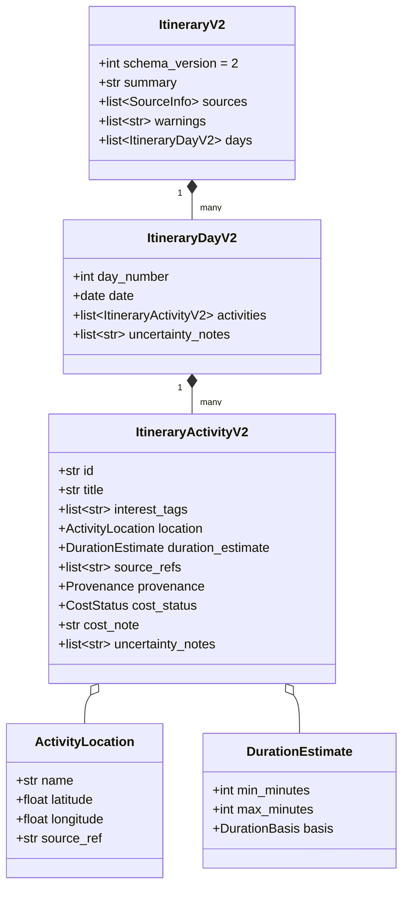

# Phase 4 & Phase 5 Reliability Contracts & Data Specifications

This document defines the reliability engineering standards, shared provider error hierarchy, retry-with-backoff policy, Itinerary Schema v2, deterministic validation rules catalog, bounded repair loops, currency-specific budget floors, automated regression case format, structured audit logging, and routing tool integration contracts for AI Travel Concierge.

---

## 1. Architectural Alignment & Non-Negotiable Boundaries

- **Product Name**: AI Travel Concierge
- **Product Classification**: Travel discovery and planning assistant, **NOT a booking engine**.
- **Strict Boundary**: Never claim or imply that a flight, hotel, rental car, tour, ticket, purchase, reservation, payment, or cancellation has occurred.
- **Indicative Travel Data Rule**: Any flight or hotel data ever displayed must explicitly include:
  1. The data source provider name (`provider`).
  2. The UTC timestamp when fetched (`fetched_at`).
  3. The mandatory disclaimer text: `"indicative, not bookable here"`.
- **Truthfulness & Provenance Taxonomy**: Every data point carries explicit provenance classification:
  - `retrieved`: Verified real-world data retrieved directly from external authoritative APIs (e.g., Open-Meteo geocoding coordinates, official weather forecasts).
  - `generated_suggestion`: Recommendations, synthesized daily schedules, and activity descriptions created by rule-based algorithms or LLM planning.
  - `estimate`: Computed approximations (e.g., heuristic activity durations or heuristic budget allocations).
  - `unknown`: Values that could not be retrieved or estimated. Never fabricated or guessed.

---

## 2. Shared Provider Error Model

- **Status**: **IMPLEMENTED (Phase 4 Task 4)**
- **Implementation**: `backend/app/providers/errors.py`
- **Tool Mapping**: `backend/app/agent/tools/contracts.py` (`provider_error_to_tool_result`)

Phase 4 unifies all external provider errors into a standardized, typed exception model (`ProviderError`) located in `backend/app/providers/errors.py`.

### Unified ProviderError Class Contract

```python
from enum import StrEnum
from typing import Any


class ProviderErrorCode(StrEnum):
    """Standardized error codes for external provider interactions."""

    TIMEOUT = "timeout"
    RATE_LIMITED = "rate_limited"
    AUTHENTICATION_FAILED = "authentication_failed"
    INVALID_RESPONSE = "invalid_response"
    EMPTY_RESULT = "empty_result"  # Normal outcome, handled as empty dataset, not exception
    INVALID_REQUEST = "invalid_request"
    PROVIDER_UNAVAILABLE = "provider_unavailable"
    UNKNOWN_FAILURE = "unknown_failure"


class ProviderError(Exception):
    """Unified exception class for all external provider interactions."""

    def __init__(
        self,
        message: str,
        code: ProviderErrorCode,
        provider: str,
        retryable: bool,
        safe_message: str,
        http_status: int | None = None,
        retry_after_seconds: float | None = None,
        details: dict[str, Any] | None = None,
    ) -> None:
        super().__init__(message)
        self.message = message
        self.code = code
        self.provider = provider
        self.retryable = retryable
        self.safe_message = safe_message
        self.http_status = http_status
        self.retry_after_seconds = retry_after_seconds
        self.details = details or {}
```

### Standard Error Codes & Retry Classification

| Error Code | HTTP Status | Retryable? | Behavior & Safe Fallback |
| :--- | :---: | :---: | :--- |
| `timeout` | 408 / 504 / Socket | **Yes** | Request timed out during connect or read. Retried via exponential backoff. Degrades to safe cached/mock data or partial itinerary if budget exhausted. |
| `rate_limited` | 429 | **Conditional** | Retried **only** if `retry_after_seconds <= max_delay` (4.0s). If `retry_after > 4.0s` or unspecified, treated as non-retryable and immediately fails to prevent worker starvation. |
| `authentication_failed` | 401 / 403 | **No** | Missing or invalid API key. **Never retried**. Degrades cleanly to `"unavailable"` with safe user message; never crashes the application or exposes credentials. |
| `invalid_response` | 200 / 502 / 503 | **No** | Malformed JSON or response schema violation from provider. **Never retried**. |
| `empty_result` | 200 | **N/A** | Normal valid outcome where provider returned zero matching records (e.g., unknown city). **Not an exception**. Handled as empty collection; workflow triggers clarification or search broadening. |
| `invalid_request` | 400 / 404 / 422 | **No** | Client input error or unprocessable query parameters. **Never retried**. |
| `provider_unavailable` | 502 / 503 | **Yes** | Upstream provider outage or gateway error. Retried up to retry budget, then degrades to fallback. |
| `unknown_failure` | 500 / Socket | **Conditional** | Transient connection drop is retryable; unclassified logic error is non-retryable. |

### Mapping from Existing Phase 2 & 3 Error Hierarchies

Phase 2 and Phase 3 error classes map directly to the unified `ProviderError` model:

| Legacy Phase 2 / Phase 3 Error | Unified `ProviderErrorCode` | `retryable` | `safe_message` |
| :--- | :--- | :---: | :--- |
| `open_meteo.errors.TimeoutError` | `ProviderErrorCode.TIMEOUT` | `True` | `"Weather service timed out. Retrying or proceeding with seasonal estimates."` |
| `open_meteo.errors.NetworkUnavailableError` | `ProviderErrorCode.PROVIDER_UNAVAILABLE` | `True` | `"Weather service connection refused. Proceeding with fallback planning."` |
| `open_meteo.errors.RateLimitExceededError` | `ProviderErrorCode.RATE_LIMITED` | `retry_after <= 4.0` | `"Weather service rate limit exceeded. Please try again shortly."` |
| `open_meteo.errors.MalformedResponseError` | `ProviderErrorCode.INVALID_RESPONSE` | `False` | `"Weather service returned an unreadable response."` |
| `open_meteo.errors.HttpError(status_code=401/403)` | `ProviderErrorCode.AUTHENTICATION_FAILED` | `False` | `"Weather service is temporarily unconfigured or unauthorized."` |
| `open_meteo.errors.HttpError(status_code=400/404/422)` | `ProviderErrorCode.INVALID_REQUEST` | `False` | `"Location query could not be processed by the weather service."` |
| `open_meteo.errors.HttpError(status_code=5xx)` | `ProviderErrorCode.PROVIDER_UNAVAILABLE` | `True` | `"Weather service is currently experiencing upstream outages."` |
| `agent.errors.ToolErrorCode.TIMEOUT` | `ProviderErrorCode.TIMEOUT` | `True` | Same as tool error envelope |
| `agent.errors.ToolErrorCode.RATE_LIMITED` | `ProviderErrorCode.RATE_LIMITED` | `Conditional` | Same as tool error envelope |
| `agent.errors.ToolErrorCode.PROVIDER_UNAVAILABLE` | `ProviderErrorCode.PROVIDER_UNAVAILABLE` | `True` | Same as tool error envelope |
| `agent.errors.ToolErrorCode.INVALID_ARGUMENTS` | `ProviderErrorCode.INVALID_REQUEST` | `False` | Same as tool error envelope |

---

## 3. Retry Policy Defaults & Guardrails

Phase 4 defines strict, deterministic retry parameters in `backend/app/core/config.py` and implements a centralized `call_with_retry` utility in `backend/app/core/retry.py` [IMPLEMENTED].

### Configured Retry Parameters

```python
from typing import Final, Literal

DEFAULT_MAX_RETRIES: Final[int] = 2  # 3 attempts total (1 initial + 2 retries)
DEFAULT_BASE_DELAY_SECONDS: Final[float] = 0.5  # Initial backoff step
DEFAULT_BACKOFF_FACTOR: Final[float] = 2.0  # Exponential factor: 0.5s -> 1.0s -> 2.0s
DEFAULT_JITTER_MODE: Literal["full"] = "full"  # Random uniform in [0, exponential_delay]
DEFAULT_MAX_DELAY_SECONDS: Final[float] = 4.0  # Ceiling for individual retry wait
DEFAULT_TOTAL_RETRY_BUDGET_SECONDS: Final[float] = 8.0  # Hard ceiling on total cumulative wait
```

### Retry Algorithm Specification

```text
delay = min(DEFAULT_MAX_DELAY_SECONDS, DEFAULT_BASE_DELAY_SECONDS * (DEFAULT_BACKOFF_FACTOR ** attempt))
if jitter == "full":
    sleep_time = random.uniform(0, delay)
else:
    sleep_time = delay
```

### Mandatory Retry Constraints
1. **Never Retry Non-Retryable Errors**: `authentication_failed`, `invalid_request`, `invalid_response`, and `empty_result` **MUST NEVER** be retried under any circumstances.
2. **`Retry-After` Header Handling**:
   - If provider responds with an HTTP `Retry-After` header, parse value in seconds.
   - If `retry_after <= DEFAULT_MAX_DELAY_SECONDS` (4.0 seconds): Sleep for `retry_after` seconds and retry (counting against `max_retries` and `total_retry_budget`).
   - If `retry_after > DEFAULT_MAX_DELAY_SECONDS` (4.0 seconds): Do not sleep. Abort retries immediately, mark `retryable = False`, and return `ProviderErrorCode.RATE_LIMITED`.
3. **Cumulative Retry Budget**: If cumulative retry wait time exceeds `DEFAULT_TOTAL_RETRY_BUDGET_SECONDS` (8.0 seconds), the retry loop terminates immediately and raises the last observed `ProviderError`.

---

## 4. Itinerary Schema v2

Phase 4 introduces `ItineraryV2` in `backend/app/schemas/itinerary_v2.py` [PLANNED]. Schema v2 provides fine-grained activity identification, duration estimates, explicit provenance, uncertainty tracking, and structured cost statuses.

### Schema Hierarchy



### Pydantic v2 Class Definitions

```python
from datetime import date
from enum import StrEnum
from typing import Literal
from pydantic import BaseModel, ConfigDict, Field, model_validator

from app.schemas.provider import Provenance, SourceInfo


class DurationBasis(StrEnum):
    """Source basis for an activity duration estimate."""

    PROVIDER = "provider"
    HEURISTIC = "heuristic"
    UNKNOWN = "unknown"


class CostStatus(StrEnum):
    """Status classification of activity cost."""

    UNKNOWN = "unknown"
    ESTIMATE = "estimate"
    RETRIEVED = "retrieved"  # Strictly requires at least one matching source_ref


class ActivityLocation(BaseModel):
    """Geographic location details for an activity."""

    model_config = ConfigDict(extra="forbid")

    name: str = Field(..., min_length=1, max_length=150)
    latitude: float | None = Field(default=None, ge=-90.0, le=90.0)
    longitude: float | None = Field(default=None, ge=-180.0, le=180.0)
    source_ref: str | None = Field(default=None, description="Key into root sources list")


class DurationEstimate(BaseModel):
    """Estimated duration of an activity."""

    model_config = ConfigDict(extra="forbid")

    min_minutes: int | None = Field(default=None, ge=5, le=1440)
    max_minutes: int | None = Field(default=None, ge=5, le=1440)
    basis: DurationBasis = Field(default=DurationBasis.HEURISTIC)

    @model_validator(mode="after")
    def validate_duration_range(self) -> "DurationEstimate":
        if (
            self.min_minutes is not None
            and self.max_minutes is not None
            and self.min_minutes > self.max_minutes
        ):
            raise ValueError("min_minutes cannot exceed max_minutes")
        return self


class ItineraryActivityV2(BaseModel):
    """Activity entry within an itinerary day (Schema v2)."""

    model_config = ConfigDict(extra="forbid")

    id: str = Field(..., min_length=1, max_length=64, description="Unique ID within version")
    title: str = Field(..., min_length=1, max_length=150)
    interest_tags: list[str] = Field(default_factory=list, max_length=10)
    location: ActivityLocation | None = None
    duration_estimate: DurationEstimate | None = None
    source_refs: list[str] = Field(
        default_factory=list,
        description="Keys into root sources list for retrieved claims",
    )
    provenance: Provenance = Field(default=Provenance.GENERATED_SUGGESTION)
    cost_status: CostStatus = Field(default=CostStatus.UNKNOWN)
    cost_note: str | None = Field(
        default=None,
        description="Non-booking cost notes or price tier estimates.",
    )
    uncertainty_notes: list[str] = Field(default_factory=list)

    @model_validator(mode="after")
    def validate_retrieved_cost_has_source(self) -> "ItineraryActivityV2":
        if self.cost_status == CostStatus.RETRIEVED and not self.source_refs:
            raise ValueError(
                "Activity with cost_status='retrieved' must specify at least one source_ref"
            )
        if self.provenance == Provenance.RETRIEVED and not self.source_refs:
            raise ValueError(
                "Activity with provenance='retrieved' must specify at least one source_ref"
            )
        return self


class ItineraryDayV2(BaseModel):
    """Day itinerary containing v2 activities."""

    model_config = ConfigDict(extra="forbid")

    day_number: int = Field(..., ge=1)
    date: date
    activities: list[ItineraryActivityV2] = Field(default_factory=list)
    uncertainty_notes: list[str] = Field(default_factory=list)


class ItineraryV2(BaseModel):
    """Root generated itinerary contract (Schema v2)."""

    model_config = ConfigDict(extra="forbid")

    schema_version: Literal[2] = 2
    summary: str = Field(..., min_length=1, max_length=500)
    sources: list[SourceInfo] = Field(default_factory=list)
    warnings: list[str] = Field(default_factory=list)
    days: list[ItineraryDayV2] = Field(default_factory=list)
```

### In-Memory v1 to v2 Upgrader (Non-Destructive)

**Invariant**: Stored v1 database records (`Itinerary` JSON payloads from Phase 2) are **NEVER** modified, overwritten, or updated in the PostgreSQL database.

When an endpoint or service reads a v1 payload, it routes through an in-memory upgrader (`upgrade_itinerary_v1_to_v2`):

```python
def upgrade_itinerary_v1_to_v2(v1: dict[str, Any]) -> dict[str, Any]:
    """Convert a stored Phase 2 Itinerary v1 dict to ItineraryV2 in memory."""
    v2_days = []
    for day in v1.get("days", []):
        day_num = day.get("day_number", 1)
        v2_activities = []
        for idx, item in enumerate(day.get("items", []), start=1):
            act_id = f"day_{day_num}_act_{idx}"
            source_ref = item.get("source_ref")
            source_refs = [source_ref] if source_ref else []

            # Translate time_of_day heuristic duration
            duration = DurationEstimate(
                min_minutes=60,
                max_minutes=180,
                basis=DurationBasis.HEURISTIC,
            )

            # Translate cost_estimate string to cost_status
            cost_est = item.get("cost_estimate")
            cost_status = CostStatus.ESTIMATE if cost_est else CostStatus.UNKNOWN

            v2_activities.append(
                ItineraryActivityV2(
                    id=act_id,
                    title=item.get("title", "Activity"),
                    interest_tags=[],
                    location=None,
                    duration_estimate=duration,
                    source_refs=source_refs,
                    provenance=item.get("provenance", Provenance.GENERATED_SUGGESTION),
                    cost_status=cost_status,
                    cost_note=cost_est,
                    uncertainty_notes=[],
                )
            )

        v2_days.append(
            ItineraryDayV2(
                day_number=day_num,
                date=day.get("date"),
                activities=v2_activities,
                uncertainty_notes=[],
            )
        )

    return ItineraryV2(
        schema_version=2,
        summary=v1.get("summary", ""),
        sources=v1.get("sources", []),
        warnings=v1.get("warnings", []),
        days=v2_days,
    ).model_dump(mode="json")
```

---

## 5. Deterministic Validation Rules Catalog

Phase 4 implements deterministic validation rules in `backend/app/agent/validation.py` [PLANNED]. Every itinerary is audited against this catalog prior to final response packaging.

### Validation Catalog Table

| Rule Code | Severity | Trigger Condition | Automated Repair Action |
| :--- | :---: | :--- | :--- |
| `DATE_RANGE_MISMATCH` | **CRITICAL** | Total days != trip duration, dates do not match `[start_date, end_date]`, or intermediate dates are missing. | Prune days outside trip date bounds. Insert empty placeholder day shells for missing dates and schedule default activities. |
| `DUPLICATE_ACTIVITY` | **WARNING** | Normalized activity title and location match an already scheduled activity in the itinerary. | Remove redundant activity. Substitute with an alternative suggestion matching one of the user's travel interests. |
| `MAX_DAILY_ACTIVITIES` | **WARNING** | Daily activity count exceeds configured pace threshold: <br> • `relaxed`: max 3 <br> • `balanced`: max 4 <br> • `packed`: max 5 | Prune lowest-priority activities on the overloaded day. Optionally redistribute to an under-scheduled day if within same city. |
| `MISSING_REQUIRED_INTEREST` | **WARNING** | A user interest specified in `TripRequest.interests` has 0 activities tagged with that interest across all days. | Replace a generic generated activity with an activity tagged with the missing interest. |
| `MISSING_SOURCE_METADATA` | **CRITICAL** | Activity marked `provenance='retrieved'` has no `source_refs`, or references a source lacking `provider`, `fetched_at`, `attribution`, or `data_origin`. | Downgrade activity provenance to `GENERATED_SUGGESTION` and append uncertainty note. |
| `BUDGET_FLOOR_VIOLATION` | **CRITICAL** | Per-person-per-day budget allocation is below the currency's Hard Floor without user confirmation. | Halt at clarification seam with `budget_conflict`. If confirmed by user, attach budget warning. |

---

## 6. Bounded Repair Policy & Terminal Outcomes

### Bounded Repair Guardrails

- **Maximum Repair Attempts**: `MAX_REPAIR_ATTEMPTS: Final[int] = 2` (configured in `backend/app/core/config.py`).
- **Circuit Breaker**: If two consecutive repair iterations yield the exact same set of validation issue codes without reduction, the repair loop halts immediately to avoid infinite oscillation.
- **Terminal Run Statuses**:
  - `completed`: 0 critical issues and 0 unhandled warnings. A complete, valid itinerary meeting all constraints.
  - `partial`: Non-critical warnings could not be fully resolved within 2 repair iterations, but core schedule is valid. Valid days and activities are preserved; unresolvable items are pruned or annotated with `uncertainty_notes`. Appropriate user notices attached to `warnings`.
  - `failed`: Date range could not be reconciled, trip duration was zero, or fatal intake contradictions prevented synthesis.
  - **Core Invariant**: An invalid itinerary is **NEVER** returned with status `completed`.

---

## 7. Budget Rules & Currency Hard Floors

To protect travelers from impossible plans, Phase 4 enforces deterministic budget heuristics without requiring real-time pricing data.

### Intake Validation
- `budget_amount <= Decimal("0")`: Hard validation error (`422 Unprocessable Entity`) at intake.

### Currency-Specific Hard Floors & Thresholds

Values represent estimated minimum daily spend per person (food, local transit, basic activities) excluding flights and hotels:

| Currency | ISO Code | Configured Hard Floor / Person / Day | Low Budget Warning Threshold |
| :--- | :---: | :---: | :---: |
| US Dollar | `USD` | **$30.00** | $50.00 |
| Euro | `EUR` | **€30.00** | €50.00 |
| British Pound | `GBP` | **£25.00** | £45.00 |
| Canadian Dollar | `CAD` | **$40.00** | $65.00 |
| Australian Dollar | `AUD` | **$45.00** | $70.00 |
| Japanese Yen | `JPY` | **¥4,000** | ¥6,500 |
| Indian Rupee | `INR` | **₹2,000** | ₹3,500 |
| Swiss Franc | `CHF` | **CHF 35.00** | CHF 55.00 |
| New Zealand Dollar | `NZD` | **$50.00** | $75.00 |
| Singapore Dollar | `SGD` | **$40.00** | $65.00 |

### Workflow Decision Logic
1. **Below Hard Floor**:
   - `daily_per_person = budget_amount / (party_size * trip_days)`
   - If `daily_per_person < HARD_FLOOR[currency]`:
     - Halts at clarification seam with `clarification_type = "budget_conflict"`.
     - Message: `"The indicated budget of {currency} {daily_per_person:.2f} per person per day is below the typical basic floor for {destination}. Please confirm if you wish to proceed with a shoestring plan or increase the budget."`
     - If user confirms in follow-up request (`confirm_low_budget=True`), execution proceeds with a prominent budget warning.
2. **Between Hard Floor and Low Threshold**:
   - Does **not** halt at clarification.
   - Sets `low_budget = True` in state.
   - Attaches advisory note to `warnings`: `"Budget is tight for {destination}. Itinerary focuses on free public sights, walking tours, and budget transit."`

---

## 8. Automated Regression Test Suite Format (JSON)

Phase 4 defines a standardized regression test fixture format in `backend/tests/fixtures/regression_cases.json` [PLANNED] consumed by `test/phase4-regression-suite`.

### JSON Schema & Sample Cases

```json
[
  {
    "id": "REG-001",
    "category": "normal",
    "description": "Standard 3-day Paris trip with balanced pace and culture interests",
    "input": {
      "origin": "London",
      "destination": "Paris",
      "start_date": "2026-06-01",
      "end_date": "2026-06-03",
      "party_size": 2,
      "budget_amount": "1200.00",
      "currency": "EUR",
      "interests": ["culture", "food"],
      "pace": "balanced"
    },
    "fake_tool_behaviours": {
      "geocode_destination": {"status": "ok", "latency_ms": 120.0},
      "weather_forecast": {"status": "ok", "latency_ms": 150.0},
      "get_route_context": {"status": "ok", "latency_ms": 200.0}
    },
    "expected_status": "completed",
    "expected_warning_codes": [],
    "expected_tool_call_counts": {
      "geocode_destination": 1,
      "weather_forecast": 1,
      "get_route_context": 1
    }
  },
  {
    "id": "REG-002",
    "category": "impossible_budget",
    "description": "Tokyo trip with budget below JPY hard floor ($10/day equivalent)",
    "input": {
      "origin": "San Francisco",
      "destination": "Tokyo",
      "start_date": "2026-07-01",
      "end_date": "2026-07-05",
      "party_size": 1,
      "budget_amount": "5000",
      "currency": "JPY",
      "interests": ["anime", "food"],
      "pace": "balanced"
    },
    "fake_tool_behaviours": {},
    "expected_status": "needs_clarification",
    "expected_warning_codes": ["BUDGET_FLOOR_VIOLATION"],
    "expected_tool_call_counts": {}
  },
  {
    "id": "REG-003",
    "category": "timeout",
    "description": "Weather provider times out across all retry attempts; degrades to partial",
    "input": {
      "origin": "New York",
      "destination": "Rome",
      "start_date": "2026-08-10",
      "end_date": "2026-08-13",
      "party_size": 2,
      "budget_amount": "2000.00",
      "currency": "EUR",
      "interests": ["history"],
      "pace": "relaxed"
    },
    "fake_tool_behaviours": {
      "geocode_destination": {"status": "ok", "latency_ms": 100.0},
      "weather_forecast": {"status": "timeout", "attempts": 3, "latency_ms": 3000.0}
    },
    "expected_status": "partial",
    "expected_warning_codes": ["WEATHER_UNAVAILABLE"],
    "expected_tool_call_counts": {
      "geocode_destination": 1,
      "weather_forecast": 3
    }
  },
  {
    "id": "REG-004",
    "category": "rate_limit",
    "description": "Routing provider returns HTTP 429 with Retry-After > 4.0s; aborts retries",
    "input": {
      "origin": "Boston",
      "destination": "Montreal",
      "start_date": "2026-09-01",
      "end_date": "2026-09-03",
      "party_size": 1,
      "budget_amount": "800.00",
      "currency": "CAD",
      "interests": ["food"],
      "pace": "balanced"
    },
    "fake_tool_behaviours": {
      "geocode_destination": {"status": "ok"},
      "weather_forecast": {"status": "ok"},
      "get_route_context": {"status": "rate_limited", "retry_after": 30.0}
    },
    "expected_status": "partial",
    "expected_warning_codes": ["ROUTING_RATE_LIMITED"],
    "expected_tool_call_counts": {
      "geocode_destination": 1,
      "weather_forecast": 1,
      "get_route_context": 1
    }
  }
]
```

---

## 9. Structured Audit Logging & Redaction Policy

To enable production observability without leaking confidential user information or credentials, Phase 4 defines standard structured logging in `backend/app/core/logging.py` [PLANNED].

### Structured JSON Event Fields

```json
{
  "event_name": "tool_execution",
  "request_id": "9b1deb4d-3b7d-4bad-9bdd-2b0d7b3dcb6d",
  "node": "execute_tools",
  "tool": "get_route_context",
  "attempt": 2,
  "latency_ms": 420.5,
  "status": "retry",
  "error_code": "timeout",
  "retry_delay_ms": 500.0,
  "timestamp": "2026-11-09T18:00:00.000Z"
}
```

### Sanitization & Redaction Rules
1. **URL Sanitization (`sanitize_url`)**: Query parameters, basic auth credentials, and embedded tokens are stripped before logging provider URLs.
2. **Secret Scrubbing**: Any string or dictionary key matching `api_key`, `secret`, `token`, `password`, `authorization`, or `bearer` must be replaced with `"[REDACTED]"`.
3. **No PII in Telemetry**: Traveler names, personal emails, or exact street addresses are not emitted to INFO logs; only high-level city/region names and request UUIDs are recorded.

---

## 10. Default Third Tool: `get_route_context` (Routing)

Phase 4 introduces a third research tool to augment geocoding and weather:

- **Tool Name**: `get_route_context`
- **Module Location**: `backend/app/agent/tools/route.py` [PLANNED]
- **Purpose**: Provides travel distance, estimated transit time, and transit modality options (walking, transit, driving) between origin/destination or between daily points of interest.
- **Contract Schema**:
  - Input: `RouteRequest(origin_coords: tuple[float, float], dest_coords: tuple[float, float], mode: Literal["transit", "walking", "driving"])`
  - Output: `RouteContext(distance_km: float, duration_minutes: int, mode: str, summary: str, provenance: Provenance = Provenance.RETRIEVED, source_ref: str)`
- **Offline Determinism**: Deterministic mock provider and offline fixture database (`route_fixtures.json`) guarantee 100% offline test suite execution.
- **Final Provider Selection**: Open-source routing provider (e.g. OSRM or OpenRouteService) evaluated and confirmed in Prompt 3.
